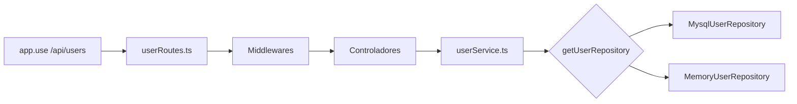

# Notas Express (Rutas y Mapeo)

## Idea base

- `express()` crea una instancia de aplicacion.
- `Router()` crea una instancia de router.
- `app.use('/x', router)` monta un router bajo un prefijo.
- `router.get(...)`, `router.post(...)`, etc. registran handlers dentro del router.
- `export default router` exporta el router ya configurado.

## Como leer `app.use('/x', router)`

- `'/x'` es el prefijo de montaje.
- Express usa ese prefijo para decidir si delega la request al router.
- Si la ruta coincide, Express entrega al router solo la parte restante.
- Ejemplo:
  - `app.use('/api/users', userRoutes)`
  - request real: `GET /api/users/123`
  - el router ve el path restante: `/:userId`

## Orden de procesamiento

- Primero se ejecutan los middleware montados antes del router.
- Luego Express intenta hacer match de ruta dentro del router.
- Si la ruta coincide, se ejecuta la cadena de middleware del endpoint.
- Al final se ejecuta el handler principal del controller.

## Terminologia util para entrevistas

- `application instance`: el objeto devuelto por `express()`.
- `router instance`: el objeto devuelto por `Router()`.
- `mounting`: registrar un router bajo un prefijo con `app.use('/x', router)`.
- `middleware chain`: secuencia de funciones que procesan la request.
- `route handler`: funcion final que responde la request.

## Ejemplo mental

```ts
const app = express();
const router = Router();

router.get('/:userId', getUserById);
app.use('/api/users', router);
```

Lectura:

- `app` recibe todas las requests.
- `'/api/users'` filtra el grupo de requests que van al router.
- `router` decide si `/:userId` coincide.
- `getUserById` responde al final.

## Regla practica

- `app` organiza la aplicacion completa.
- `router` organiza un subarbol de rutas.
- `app.use` conecta ambos.

## Mapa de `app.use('/api/users', userRoutes)`



### Piezas (con enlaces)

- Router: [userRoutes.ts](../../backend/src/routes/userRoutes.ts). Mapea método+URL a una cadena de funciones. El orden importa: `/by-email/:email` va antes de `/:userId`, o `/:userId` lo capturaría.
- Middlewares:
  - [auth.ts](../../backend/src/middleware/auth.ts) (`verifyUserToken`): decodifica el JWT y llena `req.user` y `req.apiKey`.
  - [attachApiKeyScopes.ts](../../backend/src/middleware/attachApiKeyScopes.ts): copia los scopes a `req.apiKey`.
  - [requireScope.ts](../../backend/src/middleware/requireScope.ts): exige un scope como `*:read:users`.
  - [requireAppAccess.ts](../../backend/src/middleware/requireAppAccess.ts): exige acceso al `appId` pedido.
- Controladores (capa HTTP: leen `req`, validan, llaman servicios, arman `res`; sin SQL):
  - [userController.ts](../../backend/src/controllers/userController.ts): listar, obtener, registrar, buscar por email, apps del usuario.
  - [userScopeController.ts](../../backend/src/controllers/userScopeController.ts): scopes directos y `revokedScopes`.
  - [userAppRoleController.ts](../../backend/src/controllers/userAppRoleController.ts): asignar/quitar rol por app.
  - [requestParams.ts](../../backend/src/controllers/helpers/requestParams.ts): helpers de validación compartidos.
- Servicio: [userService.ts](../../backend/src/services/userService.ts). Funciones delgadas que piden el repositorio; los controladores no saben si hay MySQL o memoria.
- Contrato: [userRepository.ts](../../backend/src/repositories/userRepository.ts) (`IUserRepository`, `AppRole`, `RegisteredUser`).
- Adaptadores: [MysqlUserRepository.ts](../../backend/src/repositories/mysql/MysqlUserRepository.ts) (SQL real) y [MemoryUserRepository.ts](../../backend/src/repositories/memory/MemoryUserRepository.ts) (fallback).
- Modelo: [user.ts](../../backend/src/models/user.ts).
- Transversales: `ROLE_SCOPES` en [authorizationService.ts](../../backend/src/services/authorizationService.ts), `logAudit` en [auditLog.ts](../../backend/src/audit/auditLog.ts), tipos en [authPayloads.ts](../../backend/src/auth/authPayloads.ts) y [express.d.ts](../../backend/src/types/express.d.ts).

### Rutas

| Ruta | Middlewares | Handler |
|------|-------------|---------|
| `GET /` | token, attachApiKeyScopes, `read:users` | `listUsers` |
| `POST /` | token, `write:users` | `registerUser` |
| `GET /by-email/:email` | token, `read:users` | `getUserByEmail` |
| `GET /by-username/:username` | token, `read:users` | `getUserByUsername` |
| `GET /:userId/apps` | token, propio o `read:users` | `getUserApps` |
| `POST /:userId/apps` | token, `write:users`, acceso a app (body) | `assignUserAppRole` |
| `DELETE /:userId/apps/:appId` | token, `write:users`, acceso a app (params) | `removeUserAppRole` |
| `GET /:userId` | token, propio o `read:users` | `getUserById` |
| `GET /:userId/scopes` | token (propio o admin, en el controlador) | `getUserScopes` |
| `POST/DELETE /:userId/scopes` | token, `write:users` | `addUserScope`, `removeUserScope` |
| `POST/DELETE /:userId/revoked-scopes` | token, `write:users` | `addUserRevokedScope`, `removeUserRevokedScope` |

### Hallazgos (cerrados 2026-10-30)

1. `/by-username/:username` usaba `getUserByEmail` (leía `req.params.email`, siempre 404) → ahora usa `getUserByUsername`.
2. POST/DELETE en `/scopes` y `/revoked-scopes` solo exigían token → ahora exigen `requireScope write:users`.
3. `GET /:userId`, `/:userId/apps`, `/by-email` y `/by-username` eran públicos y devolvían `passwordHash` → ahora exigen token ([requireSelfOrScope.ts](../../backend/src/middleware/requireSelfOrScope.ts) o `read:users`) y las respuestas pasan por `toPublicUser` ([userResponse.ts](../../backend/src/controllers/helpers/userResponse.ts)). `getUserApps` además ignoraba `:userId` si había token; ahora usa el parámetro.

Pruebas: [userAccess.test.ts](../../backend/src/tests/userAccess.test.ts).

## Modularización de controladores de usuario

Se separó el antiguo `userController.ts` (≈350 líneas) sin cambiar comportamiento:

- scopes → `userScopeController.ts` (la validación duplicada pasó a `validateScope`; la carga de listas a `loadUserScopes`).
- roles por app → `userAppRoleController.ts`.
- `if (!userId) return 400` repetidos → `requireParam(req, 'userId')`.

Verificado con `npx tsc --noEmit -p .`, `node --test dist/tests/*.js` (10 pass) y smoke test HTTP. Nota: `npm test` falla por el script (`node --test dist/tests` con directorio no funciona en Node 22), preexistente.
